# Guía de pruebas: exclusiones del .gitignore y permisos de colaboradores

Este documento describe cómo comprobar que las exclusiones del `.gitignore` funcionan y cómo probar los niveles de permiso de un colaborador en GitHub. Cada paso indica qué captura hacer y dónde insertarla.

## Requisitos previos

- Git instalado en el equipo (`git --version`).
- El repositorio clonado en tu equipo.
- Una segunda cuenta de GitHub (de un compañero o de prueba) para los apartados de permisos.
- Una ventana de terminal abierta en la carpeta del proyecto.

---

## Parte A. Comprobar el `.gitignore`

### A1. Crear archivos de prueba

Desde la raíz del repositorio, crea archivos que deben ignorarse y uno que no:

```bash
echo "API_KEY=prueba123" > .env
echo "API_KEY=ejemplo" > .env.example
echo "prueba" > temporal.tmp
mkdir -p node_modules && echo "x" > node_modules/archivo.js
```

### A2. Comprobar con `git status`

```bash
git status
```

Resultado esperado:

- `.env` **no** aparece en la lista.
- `.env.example` **sí** aparece, porque la regla `!.env.example` lo deja fuera de la exclusión.
- `temporal.tmp` y `node_modules/` **no** aparecen.

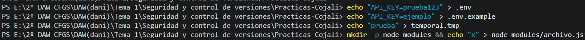

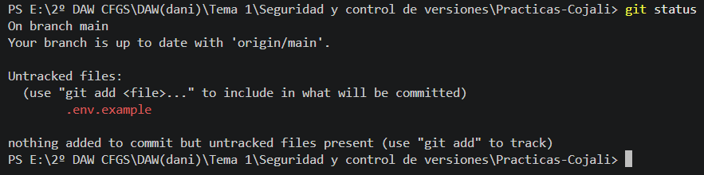

### A3. Comprobar qué regla bloquea cada archivo

```bash
git check-ignore -v .env
git check-ignore -v temporal.tmp
git check-ignore -v .env.example
```

Resultado esperado:

- `.env` muestra la línea del `.gitignore` que lo bloquea, por ejemplo `.gitignore:3:.env`.
- `temporal.tmp` muestra la regla `*.tmp`.
- `.env.example` **no devuelve nada**, porque no está ignorado.

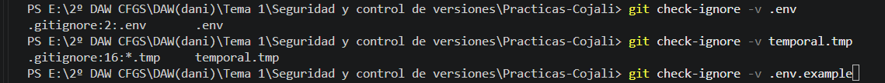

### A4. Comprobar que un archivo ya subido no se ignora

El `.gitignore` solo afecta a archivos no versionados. Para comprobarlo, versiona temporalmente un archivo sensible y luego sácalo del índice:

```bash
git add -f .env
git status
git rm --cached .env
git status
```

- Con `git add -f`, el archivo se añade a pesar de la regla, y `git status` lo muestra en verde.
- Con `git rm --cached`, se quita del control de versiones, pero **el archivo sigue en tu disco**.

Comprueba que el archivo sigue existiendo con `ls -la .env`.

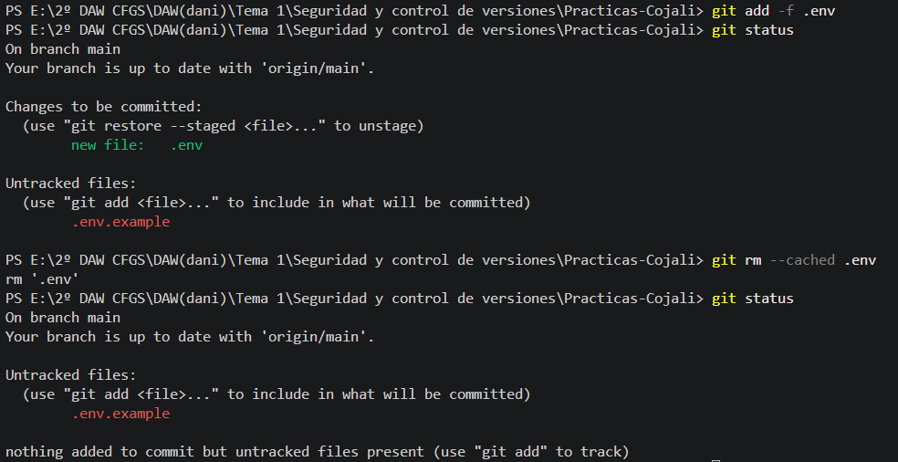

> **Nota:** si una contraseña real se hubiera subido a un commit anterior, hay que cambiarla aunque se borre el archivo, porque sigue en el historial.

### A5. Limpieza

```bash
rm -f .env .env.example temporal.tmp
rm -rf node_modules
git status
```
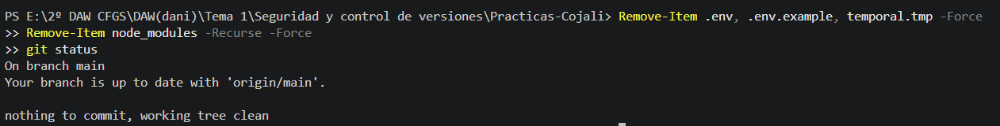

---

## Parte B. Probar los permisos de colaborador

### B1. Crear una organización y trasladar el repositorio

Como necesitamos configurar permisos diferentes para los colaboradores, trabajaremos con una organización de GitHub en lugar de mantener el repositorio únicamente en una cuenta personal.

1. Entra en GitHub y crea una organización desde [https://github.com/organizations/plan](https://github.com/organizations/plan).
2. Selecciona el plan **GitHub Free**.
3. Introduce el nombre de la organización y completa su creación.
4. Accede al repositorio y, si todavía está en tu cuenta personal, trasládalo a la organización desde **Settings → General → Danger Zone → Transfer ownership**.
5. Selecciona la organización como nuevo propietario y confirma el traslado.

### B2. Añadir al colaborador a la organización

1. Accede a la página principal de la organización.
2. Entra en **People**.
3. Pulsa **Invite member**.
4. Escribe el nombre de usuario o el correo electrónico de tu compañero.
5. Envía la invitación.
6. El compañero debe aceptar la invitación desde su correo electrónico o desde las notificaciones de GitHub.
7. Una vez aceptada la solicitud se podra añadir al usuario como colaborador y gestionar sus permisos de la forma que queramos.

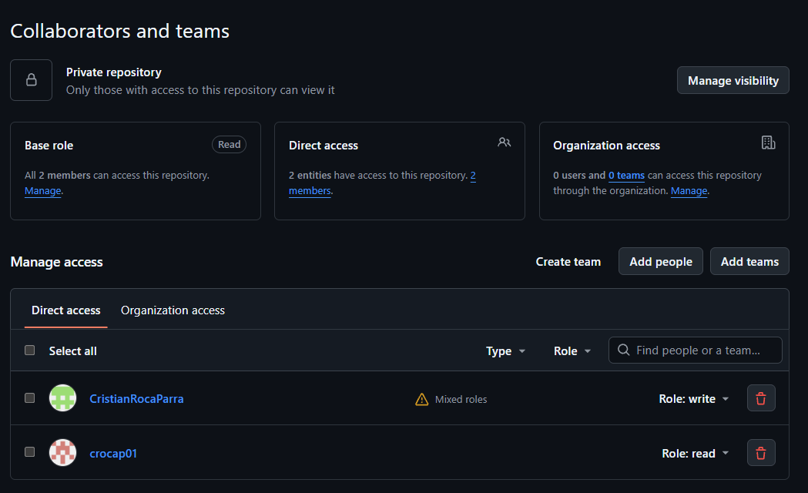

> **Nota:** si el repositorio es público, cualquier persona puede clonarlo y verlo, así que las pruebas de Read solo tienen sentido en repositorios privados.

### B2. Prueba con rol Read (solo lectura)

El compañero debe ejecutar en su equipo:

```bash
git clone https://github.com/USUARIO/REPOSITORIO.git
cd REPOSITORIO
git checkout -b prueba-read
echo "cambio" >> README.md
git add README.md
git commit -m "Prueba de permiso Read"
git push origin prueba-read
```

Resultado esperado: el clone funciona, pero el `push` falla con un error similar a:

```
remote: Permission to USUARIO/REPOSITORIO.git denied to OTRO_USUARIO.
fatal: unable to access '...': The requested URL returned error: 403
```
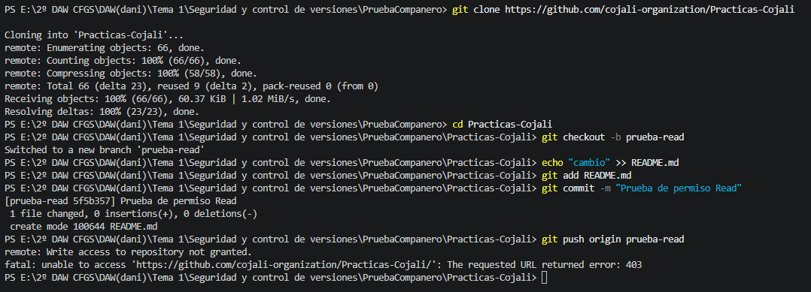

### B3. Prueba con rol Write (escritura)

En GitHub, cambia el rol del compañero a **Write** (Settings → Collaborators → Change role). Después repite el mismo proceso con otra rama:

```bash
git checkout -b prueba-write
echo "cambio" >> README.md
git add README.md
git commit -m "Prueba de permiso Write"
git push origin prueba-write
```

Resultado esperado: el push se completa y la rama aparece en GitHub. Sin embargo, en el repositorio **no aparece la pestaña Settings** para este usuario, así que no puede cambiar la configuración ni gestionar colaboradores.


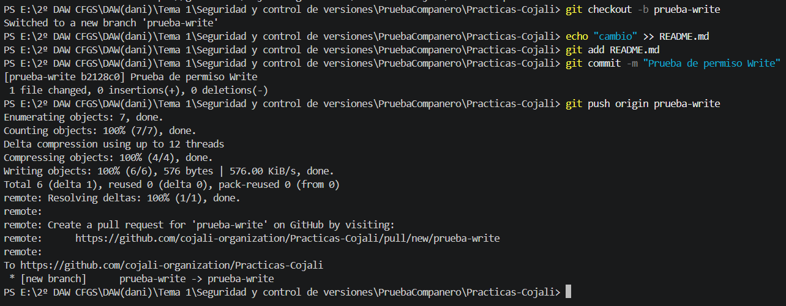

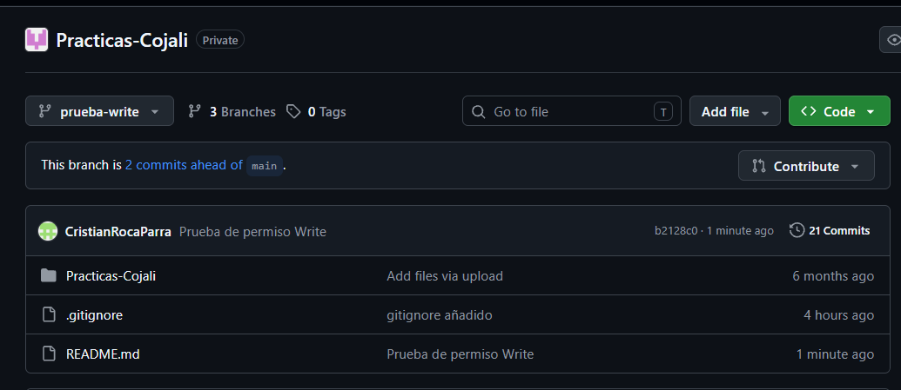

### B4. Prueba con rol Admin (administración)

Cambia el rol a **Admin** y comprueba:

- Aparece la pestaña **Settings**.
- Puede entrar en **Settings → Collaborators** y cambiar roles o eliminar colaboradores.

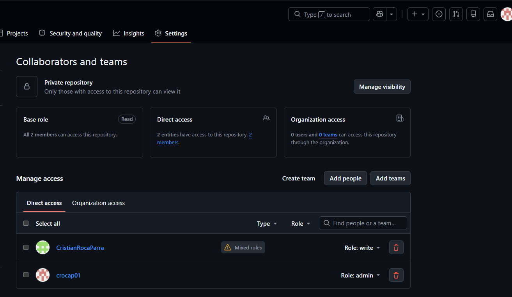

### B5. Limpieza de permisos

Cuando termines las pruebas, elimina las ramas de prueba y, si procede, quita al colaborador:

```bash
git push origin --delete prueba-read
git push origin --delete prueba-write
```

---

## Parte C. Protección de la rama principal (opcional)

Si quieres comprobar la regla de que nadie suba cambios directos a `main`:

1. En GitHub, ve a **Settings → Rules → Rulesets** (o **Branches → Add branch protection rule** en la versión clásica).
2. Crea una regla para `main` que exija pull request antes de fusionar.
3. Con un colaborador de rol Write, intenta un push directo a `main`. Debe rechazarse.

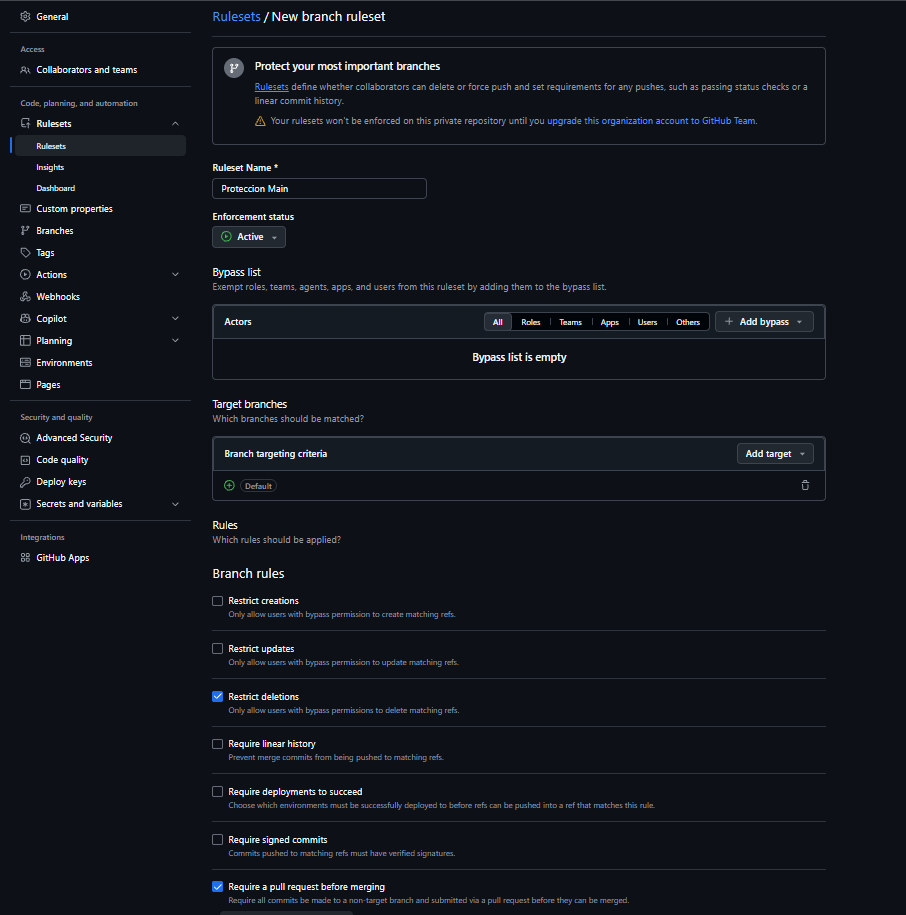

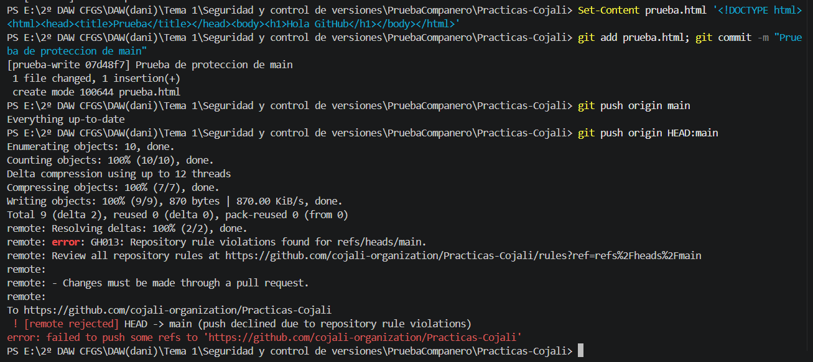

> **Nota:** en repositorios privados de cuentas gratuitas, algunas reglas de rama pueden no estar disponibles. Si ocurre, documéntalo como limitación en el `SECURITY.md`.

---

## Resumen de permisos recomendados por rol

| Rol en el equipo | Permiso recomendado | Justificación |
|---|---|---|
| Profesor o revisor externo | Read | Solo necesita consultar el código y la documentación. |
| Desarrollador del equipo | Write | Debe subir ramas y cambios, pero no gestionar el repositorio. |
| Responsable del proyecto | Admin (máximo 1 o 2 personas) | Gestiona colaboradores, reglas de rama y configuración. |

El principio general es el de **mínimo privilegio**: cada persona tiene solo el permiso que necesita para su tarea.

---

## Conclusión

Las pruebas demuestran que el `.gitignore` excluye los archivos sensibles sin bloquear los ejemplos (`.env.example`), y que cada nivel de permiso (Read, Write, Admin) limita las acciones del colaborador según lo previsto.