# Documentación y análisis: Ubuntu, Docker Desktop y despliegue de aplicaciones web

**Alumno:** Cristian Roca Parra
**Curso:** 2º DAW
**Fecha:** 22/11/26

## Índice

1. [Introducción](#1-introducción)
2. [Instalación de Ubuntu](#2-instalación-de-ubuntu)
   - [Descarga de la ISO de Ubuntu](#21-descarga-de-la-iso-de-ubuntu)
   - [Creación de la máquina virtual](#22-creación-de-la-máquina-virtual)
   - [Escritorio Ubuntu](#23-escritorio-ubuntu)
3. [Instalación de Docker Desktop](#3-instalación-de-docker-desktop)
4. [Creación y ejecución de contenedores](#4-creación-y-ejecución-de-contenedores)
   - [Creación de contenedores](#41-creación-de-contenedores)
   - [Ejecución y comprobación](#42-ejecución-y-comprobación)
   - [Apagar contenedores](#43-apagar-contenedores)
5. [Requisitos mínimos para implantar una aplicación web](#5-requisitos-mínimos-para-implantar-una-aplicación-web)
   - [Requisitos de hardware y software](#51-requisitos-de-hardware-y-software)
   - [Infraestructura de red](#52-infraestructura-de-red)
   - [Configuración del servidor web y de aplicaciones](#53-configuración-del-servidor-web-y-de-aplicaciones)
   - [Seguridad y mantenimiento](#54-seguridad-y-mantenimiento)
6. [Conclusión](#6-conclusión)
7. [Bibliografía](#7-bibliografía)
8. [Anexos](#8-anexos)

---

## 1. Introducción

En este documento se describe el proceso de instalación de Ubuntu en una máquina virtual mediante VirtualBox, la instalación y configuración de Docker Desktop y los comandos utilizados para crear y ejecutar contenedores.

Además, se analizan los requisitos mínimos necesarios para implantar una aplicación web, teniendo en cuenta el hardware, el software, la infraestructura de red, la configuración del servidor y las medidas de seguridad y mantenimiento.

## 2. Instalación de Ubuntu

### 2.1. Descarga de la ISO de Ubuntu

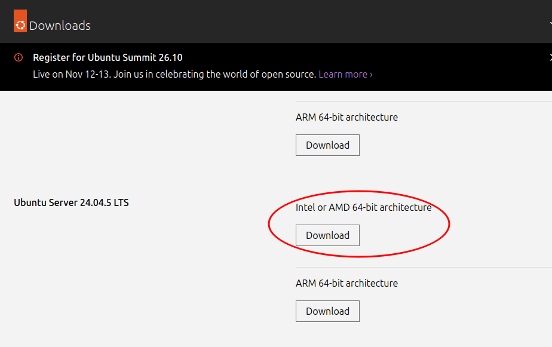

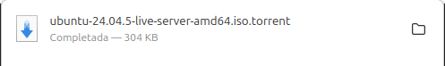

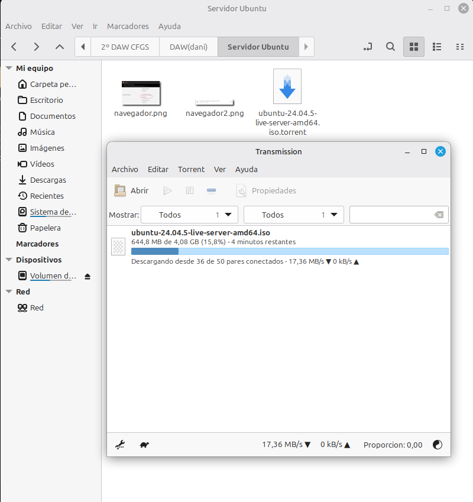

### 2.2. Creación de la máquina virtual

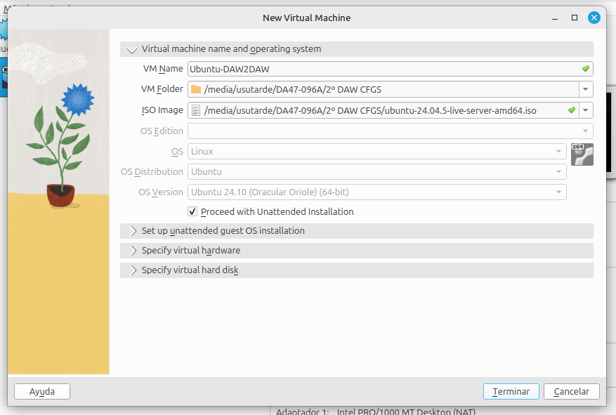

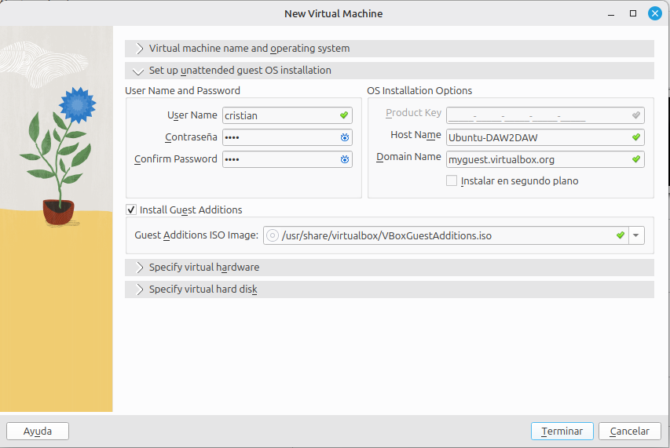

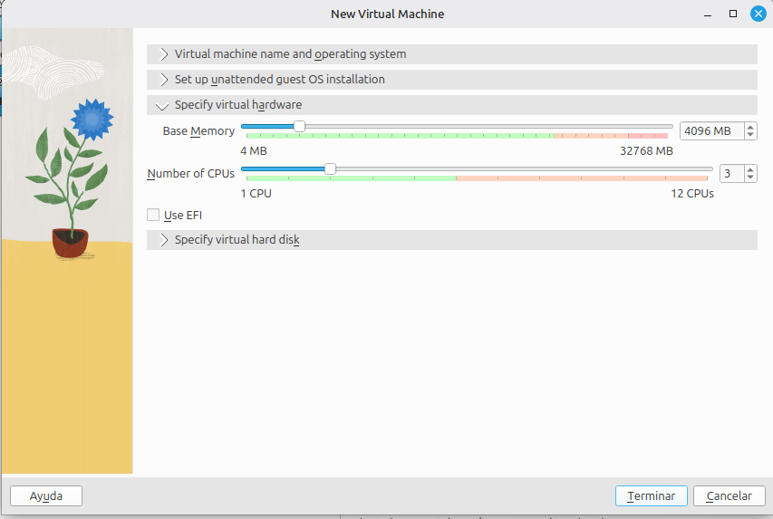

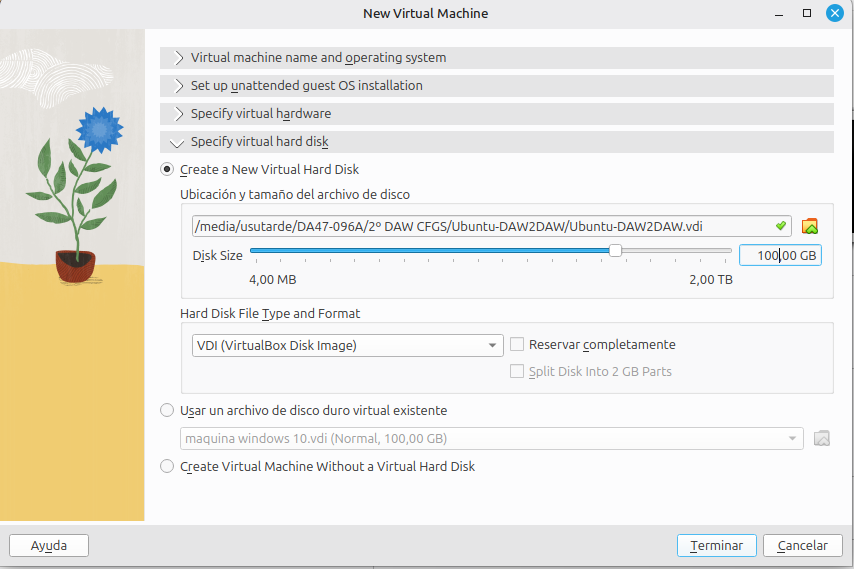

### 2.3. Escritorio Ubuntu

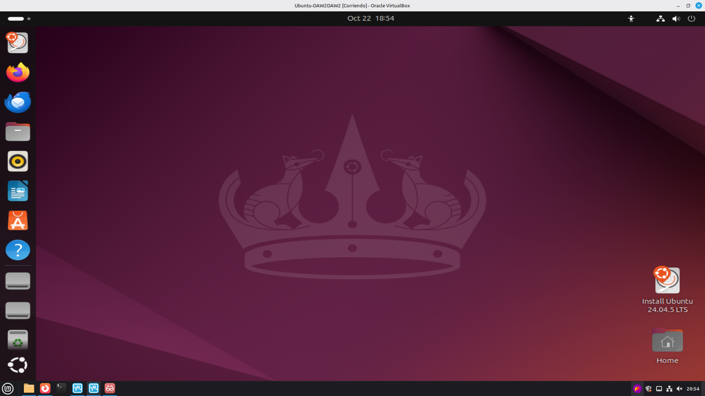

## 3. Instalación de Docker Desktop

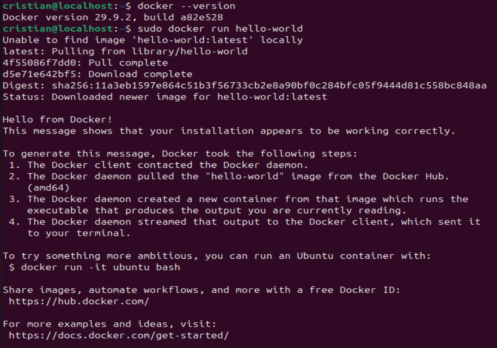

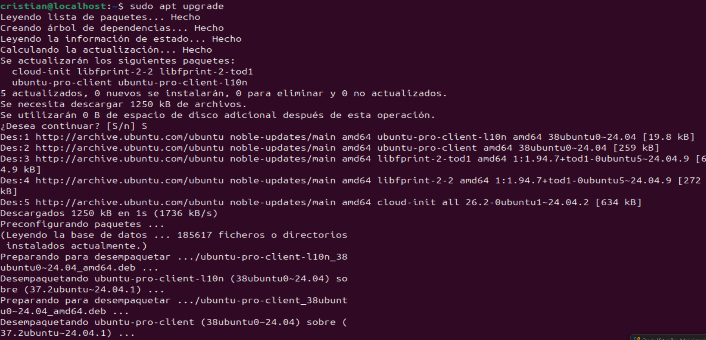

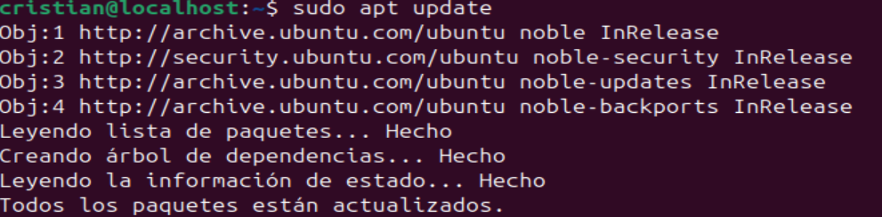

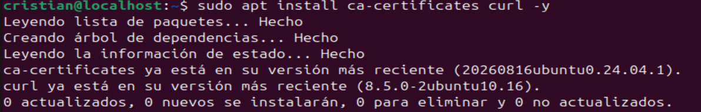

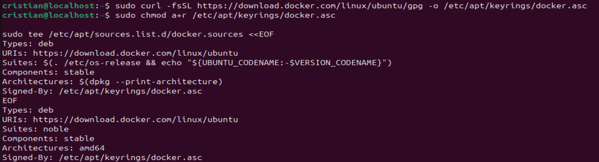

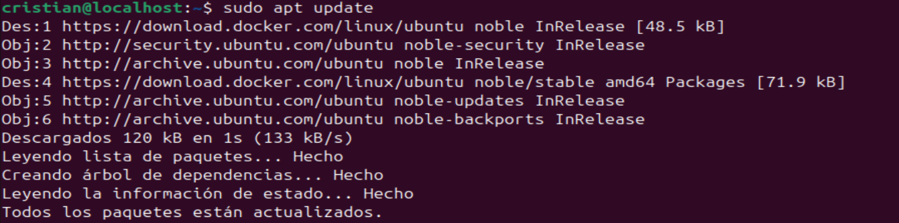

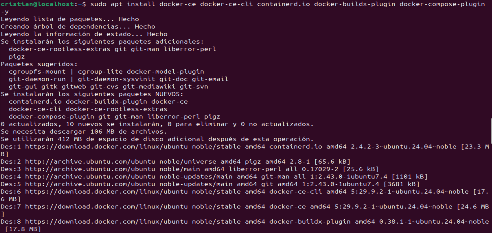

## 4. Creación y ejecución de contenedores

### 4.1. Creación de contenedores

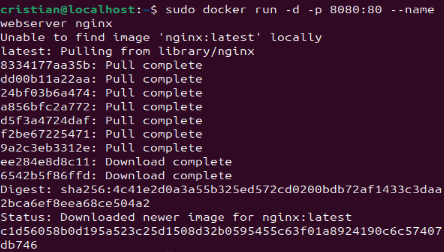

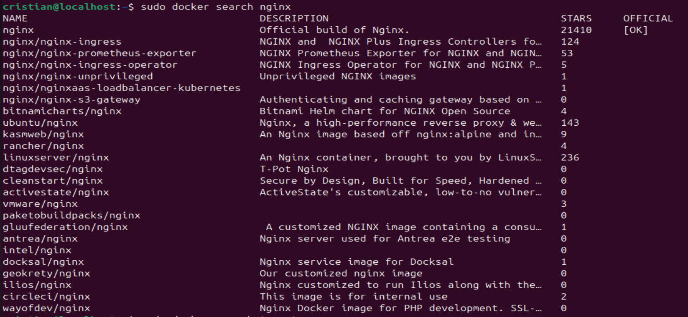

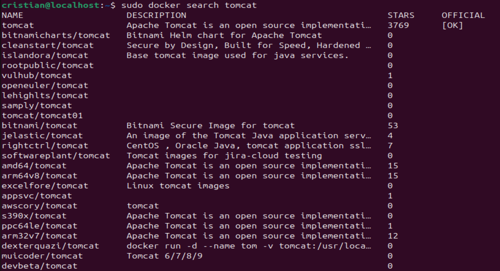

### 4.2. Ejecución y comprobación

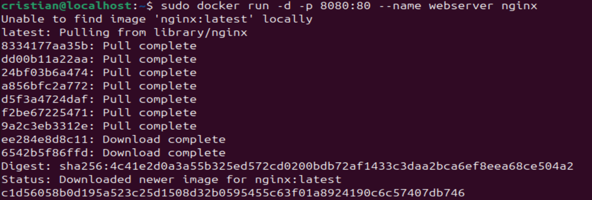

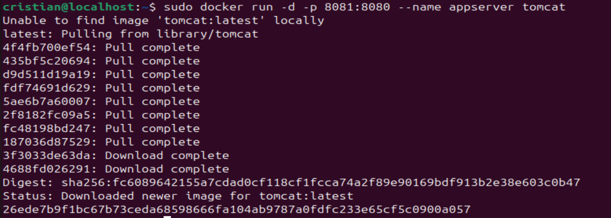

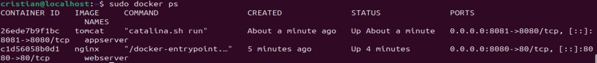

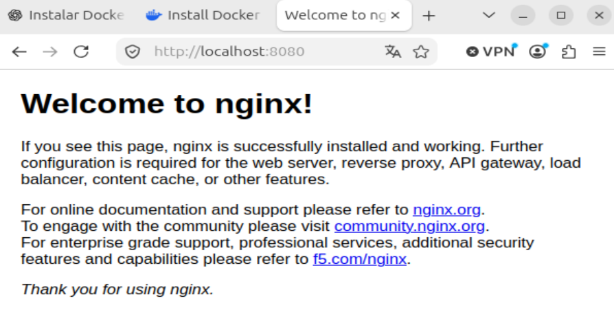

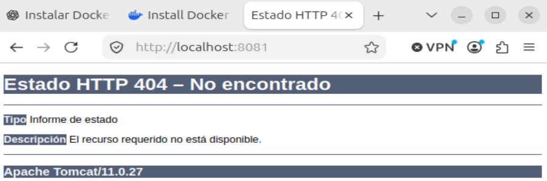

### 4.3. Apagar contenedores

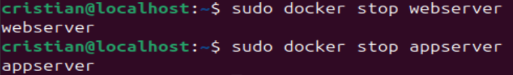

## 5. Requisitos mínimos para implantar una aplicación web

Para instalar una aplicación web es necesario disponer de un equipo adecuado, los programas necesarios y una conexión de red que permita acceder a ella.

### 5.1. Requisitos de hardware y software

**Hardware:**
- Procesador de al menos 2 núcleos.
- 4 GB de memoria RAM recomendados.
- Espacio suficiente en disco para el sistema y la aplicación.
- Conexión a Internet o a una red local.

**Software:**
- Sistema operativo, como Ubuntu.
- Servidor web, como Apache o Nginx.
- Lenguaje de programación necesario para la aplicación.
- Base de datos, si es necesaria.
- Docker para ejecutar la aplicación mediante contenedores.

### 5.2. Infraestructura de red

Es necesario que el servidor tenga una conexión de red y una dirección IP para que los usuarios puedan acceder a la aplicación.

También se deben configurar los puertos 80 (HTTP) y 443 (HTTPS), además del DNS si se utiliza un dominio. El firewall debe controlar las conexiones para evitar accesos no autorizados.

### 5.3. Configuración del servidor web y de aplicaciones

Para poner en funcionamiento una aplicación web hay que instalar y configurar un servidor web, como Apache o Nginx, y colocar los archivos de la aplicación en el directorio correspondiente.

También se deben instalar las herramientas necesarias, configurar la base de datos si se utiliza y comprobar que la aplicación funciona correctamente.

Docker permite ejecutar los distintos servicios mediante contenedores, facilitando su instalación y administración.

### 5.4. Seguridad y mantenimiento

Para mantener la aplicación protegida y funcionando correctamente es importante:

- Mantener actualizado el sistema y los programas.
- Utilizar contraseñas seguras.
- Configurar correctamente los permisos y el firewall.
- Utilizar HTTPS para proteger las comunicaciones.
- Realizar copias de seguridad periódicas.
- Revisar que el servidor y la aplicación funcionan correctamente.

## 6. Conclusión

Con esta práctica se aprende a instalar Ubuntu en VirtualBox y a utilizar Docker Desktop para crear y ejecutar contenedores. También se conocen los requisitos necesarios para poner en funcionamiento una aplicación web.

Docker facilita el despliegue de aplicaciones porque permite utilizar entornos aislados y simplifica la instalación y administración de sus componentes.

## 7. Bibliografía

- [Documentación oficial de Ubuntu](https://ubuntu.com/tutorials).
- [Documentación oficial de VirtualBox](https://www.virtualbox.org/manual/).
- [Documentación oficial de Docker](https://docs.docker.com/).
- [Documentación de Apache](https://httpd.apache.org/docs/).

## 8. Anexos

En este apartado se pueden incluir capturas de pantalla adicionales, comandos utilizados durante la práctica y cualquier información complementaria que ayude a comprender el proceso realizado.