# Instalación y configuración de un servidor web Apache en Ubuntu

**Autor/a:** [Cristian Roca Parra]
**Curso / Módulo:** [2º DAW – Despliegue de Aplicaciones Web]
**Fecha:** [10/11/2026]

---

## Resumen

> *En este trabajo se documenta la instalación y configuración del servidor web Apache2 sobre Ubuntu 24.04.5.1. Se ha creado un sitio web personalizado, se ha configurado un VirtualHost propio y se ha habilitado mediante `a2ensite`. Además, se ha puesto en práctica un tutorial adicional sobre [control de acceso]. Cada fase se ha verificado con un banco de pruebas, incluyendo pruebas desde otro equipo realizadas por un compañero. Los resultados obtenidos han sido [Prueba desde otro ordenador](#28-prueba-desde-otro-ordenador) y los principales problemas encontrados fueron [Presentación y valoración de resultados](#3-presentación-y-valoración-de-resultados). Como conclusión, [Conclusión](#4-conclusión).*

## Palabras clave

`Apache2` · `Ubuntu` · `Servidor web` · `VirtualHost` · `HTTP` · `Control de acceso` · `Configuración` · `Linux`

## Índice

1. [Introducción](#1-introducción)
   1. [Contexto](#11-contexto)
   2. [Entorno utilizado: Apache](#12-entorno-utilizado-apache)
   3. [Alternativas](#13-alternativas)
   4. [Motivación](#14-motivación)
2. [Relación de actividades realizadas](#2-relación-de-actividades-realizadas)
3. [Presentación y valoración de resultados](#3-presentación-y-valoración-de-resultados)
4. [Conclusión](#4-conclusión)
5. [Bibliografía](#5-bibliografía)
6. [Anexos](#6-anexos)

---

## 1. Introducción

### 1.1. Contexto

El proyecto se realiza en el instituto IES Juan Bosco, dentro del módulo de Despliegue de aplicaciones web del ciclo 2ºDAW. El trabajo se desarrolla de forma individual en una máquina virtual con las siguientes características:

| Parámetro | Configuración |
|---|---|
| Sistema operativo | Ubuntu Server/Desktop 24.04.5.1 LTS |
| Hipervisor | Oracle VirtualBox |
| RAM / CPU / Disco | 10 GB / 3 vCPU / 100 GB |
| Red | Adaptador puente |
| IP de la máquina | 192.168.1.141 |

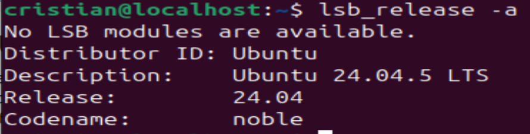


### 1.2. Entorno utilizado: Apache

**¿Qué es?** Apache HTTP Server (o simplemente *Apache*) es un servidor web de código abierto y multiplataforma. Su función es recibir peticiones HTTP/HTTPS de los clientes (navegadores) y responder con el contenido solicitado: páginas HTML, imágenes, archivos o resultados de aplicaciones dinámicas (PHP, Python, etc.).

**¿Para qué sirve?**
- Alojar sitios web estáticos y dinámicos.
- Servir varios sitios en un mismo servidor mediante *VirtualHosts*.
- Controlar el acceso a recursos (autenticación, restricciones por IP).
- Ampliar funcionalidades mediante módulos (SSL, reescritura de URLs, proxy, etc.).

**Historia (resumen):**
- **1995:** nace a partir del servidor NCSA HTTPd, mantenido mediante parches aportados por una comunidad de desarrolladores.
- **1999:** se funda la *Apache Software Foundation* para dar soporte legal y organizativo al proyecto.
- **Años posteriores:** durante mucho tiempo fue el servidor web más utilizado del mundo. La rama actual es la **2.4**.


### 1.3. Alternativas

| Alternativa | Breve descripción |
|---|---|
| **Nginx** | Servidor web y proxy inverso muy ligero y eficiente con muchas conexiones simultáneas. |
| **LiteSpeed** | Servidor de alto rendimiento, compatible con la configuración de Apache; versión gratuita (OpenLiteSpeed) y de pago. |
| **Caddy** | Servidor moderno con HTTPS automático y configuración muy sencilla. |
| **Microsoft IIS** | Servidor web de Microsoft para Windows Server. |
| **Lighttpd** | Servidor muy ligero, pensado para sistemas con pocos recursos. |

### 1.4. Motivación

El objetivo de este proyecto es aprender a instalar y administrar un servidor web real, ya que es una competencia básica en el despliegue de aplicaciones web. Concretamente, se pretende:

- Instalar Apache2 en Ubuntu y comprobar que funciona correctamente.
- Crear un sitio web personalizado y publicarlo mediante un VirtualHost propio.
- Ampliar conocimientos aplicando un tutorial adicional (control de acceso).
- Documentar todo el proceso, incluyendo los errores encontrados, de forma que pueda reproducirse.

---

## Bibliografía

- Apache Software Foundation. *Apache HTTP Server Project*. https://httpd.apache.org/ *(consultado el 22/11/2026)*
- Canonical. *Install and configure Apache*. https://ubuntu.com/tutorials/install-and-configure-apache *(consultado el 22/11/2026)*


# Apache: Configuración (cuerpo de la memoria)

---

## 2. Relación de actividades realizadas

### 2.1. Instalación previa de Apache2 (paso 2 del tutorial)

```bash
sudo apt update
sudo apt install apache2 -y
sudo systemctl status apache2
```

Comprobación en el navegador (`http://localhost` o `http://IP_DE_LA_MAQUINA`): debe aparecer la página por defecto "Apache2 Ubuntu Default Page".

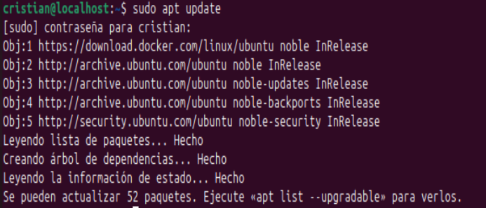

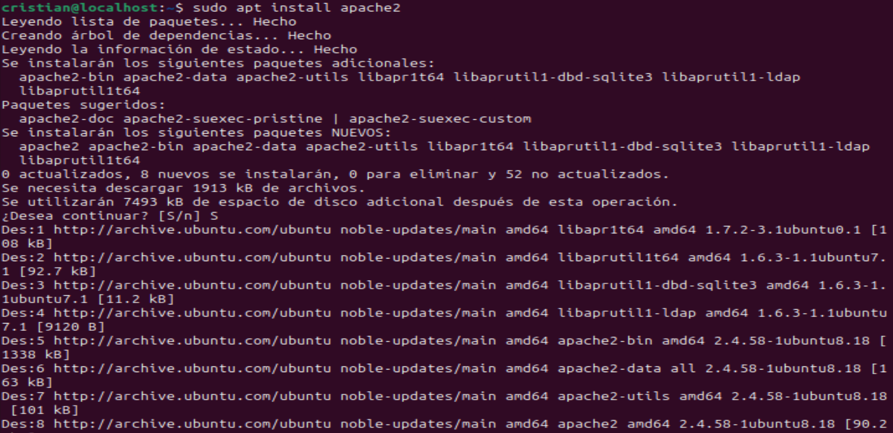

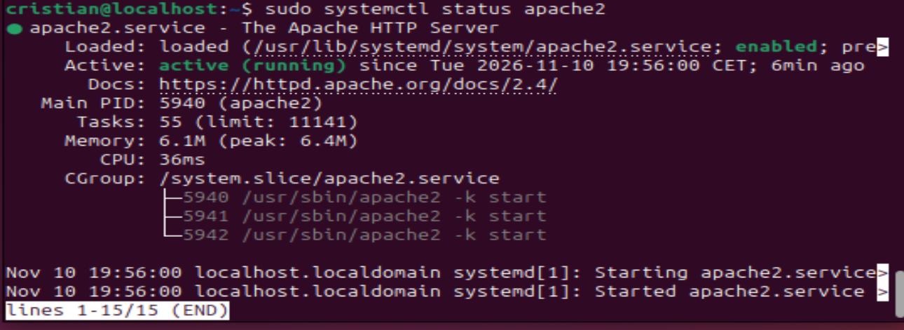

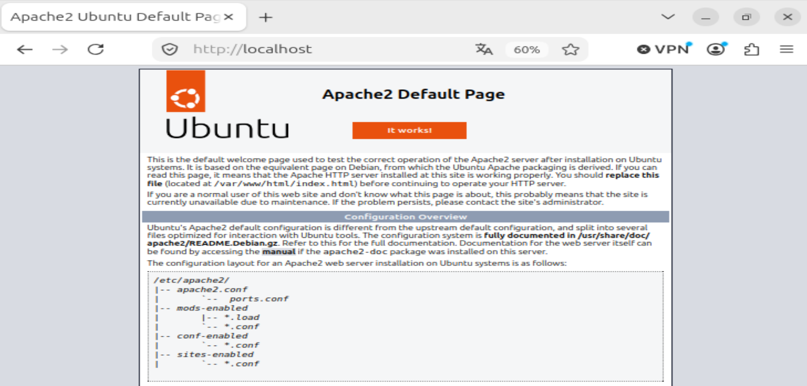

### 2.2. Paso 3: Creación de una página web personalizada

Se crea el directorio del sitio y un `index.html` con un toque personal:

```bash
sudo mkdir /var/www/gci
sudo nano /var/www/gci/index.html
```

Contenido de ejemplo:

```html
<!DOCTYPE html>
<html lang="es">
<head>
  <meta charset="UTF-8">
  <title>Sitio de [Tu nombre]</title>
  <style>
    body { font-family: Arial, sans-serif; background:#1e1e2f; color:#fff; text-align:center; padding-top:80px; }
    h1 { color:#4fc3f7; }
  </style>
</head>
<body>
  <h1>¡Bienvenido al servidor de [Tu nombre]!</h1>
  <p>Servidor Apache2 sobre Ubuntu · [Curso] · [Fecha]</p>
</body>
</html>
```

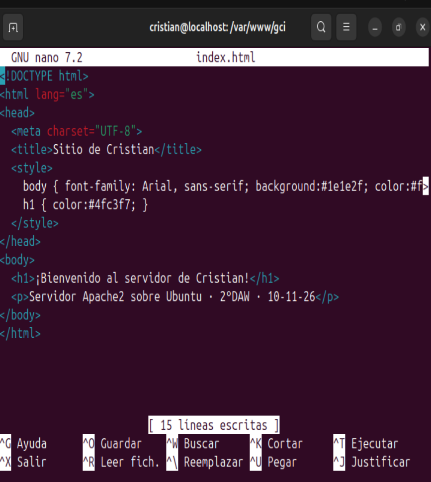

### 2.3. Paso 4: Creación del archivo de configuración del VirtualHost

```bash
cd /etc/apache2/sites-available/
sudo cp 000-default.conf gci.conf
sudo nano gci.conf
```

```apache
<VirtualHost *:80>
    ServerAdmin yourname@example.com
    DocumentRoot /var/www/gci
    ServerName gci.example.com


    ErrorLog ${APACHE_LOG_DIR}/error.log
    CustomLog ${APACHE_LOG_DIR}/access.log combined
</VirtualHost>
```

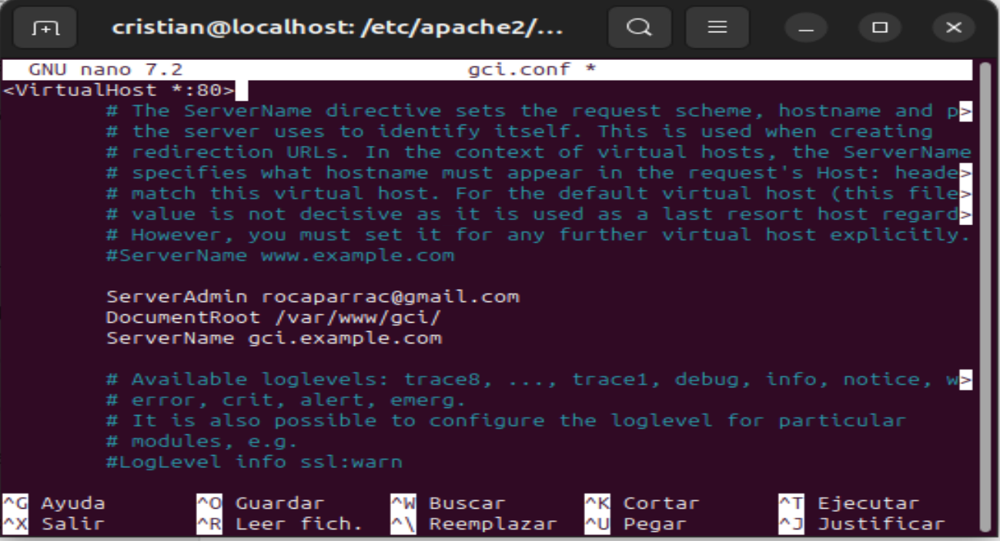

Para poder acceder por nombre, se añade al archivo `/etc/hosts` (en la máquina cliente):
Añadimos al final la siguiente linea:

```bash
  127.0.0.1 gci.example.com
```

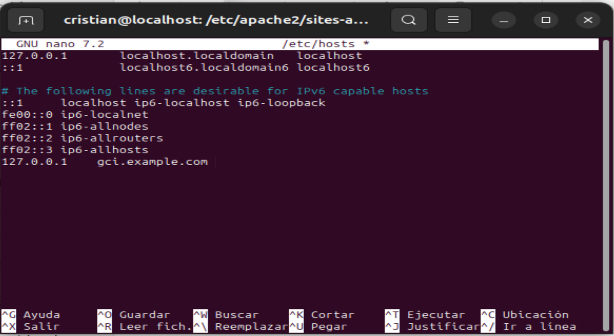


### 2.4. Paso 5: Habilitación del VirtualHost

```bash
sudo a2ensite gci.conf
sudo service apache2 reload
```

`configtest` debe responder `Syntax OK`.

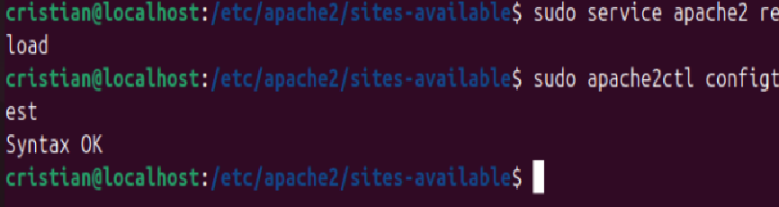

Finalemente escribimos `http://gci.example.com/` en en navegador para comprobar que todo ha salido correctamente:

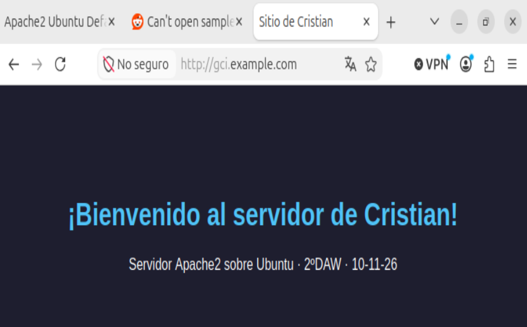

## 2.5. Tutorial adicional: control de acceso

Para mejorar la seguridad del servidor Apache, se va a configurar un sistema de control de acceso mediante usuario y contraseña. De esta forma, se protegerá una carpeta privada de la página web para que solamente puedan acceder los usuarios autorizados.

Se utilizará el método de autenticación básica (*Basic Authentication*), siguiendo la documentación oficial de Apache.

### 1. Crear la carpeta privada

Primero, creamos una carpeta llamada `privado` dentro del directorio de nuestra página web:

```bash
sudo mkdir -p /var/www/gci/privado
```

A continuación, creamos un archivo HTML para comprobar que funciona:

```bash
echo "<h1>Zona privada</h1>" | sudo tee /var/www/gci/privado/index.html
```

### 2. Crear un usuario y contraseña

Instalamos las herramientas necesarias para crear usuarios:

```bash
sudo apt install apache2-utils
```

Creamos un usuario llamado `alumno`:

```bash
sudo htpasswd -c /etc/apache2/.htpasswd alumno
```

El sistema solicitará introducir una contraseña dos veces. Esta contraseña será necesaria para acceder a la zona privada.

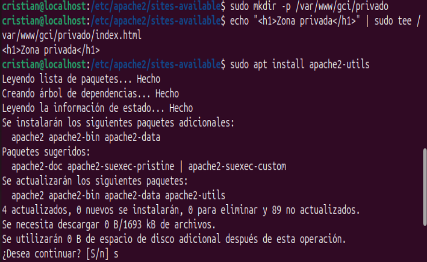

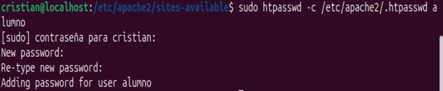

### 3. Configurar el acceso restringido en Apache

Ahora debemos modificar el archivo de configuración de nuestro sitio web.

Abrimos el archivo `gci.conf` con el siguiente comando:

```bash
sudo nano /etc/apache2/sites-available/gci.conf
```

Dentro del archivo, buscamos el bloque `<VirtualHost *:80>` y añadimos las siguientes líneas antes de `</VirtualHost>`:

```apache
<Directory /var/www/gci/privado>
    AuthType Basic
    AuthName "Zona restringida"
    AuthUserFile /etc/apache2/.htpasswd
    Require valid-user
</Directory>
```

Guardamos los cambios pulsando `Ctrl + O`, después `Enter` y finalmente `Ctrl + X` para salir del editor.

Con esta configuración, Apache solicitará un usuario y una contraseña cada vez que alguien intente acceder a la carpeta privada.

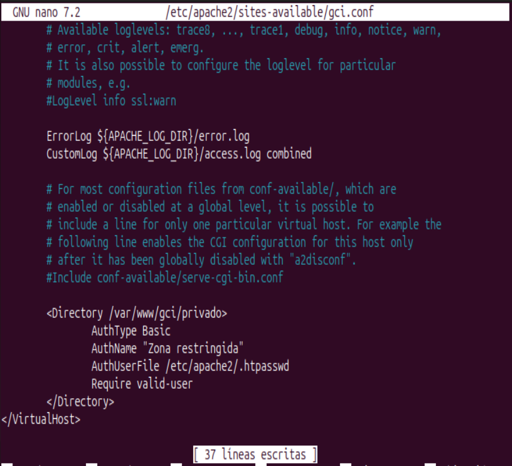

### 4. Comprobar la configuración

Antes de aplicar los cambios, comprobamos que no existen errores:

```bash
sudo apache2ctl configtest
```

Si aparece `Syntax OK`, la configuración es correcta.

Recargamos Apache para aplicar los cambios:

```bash
sudo systemctl reload apache2
```


### 5. Probar el acceso a la zona privada

Abrimos el navegador y accedemos a la siguiente dirección:

`http://gci.example.com/privado/`

Apache mostrará una ventana solicitando el usuario y la contraseña.

Si introducimos las credenciales correctas, podremos acceder a la página privada. Si introducimos datos incorrectos, el servidor denegará el acceso.

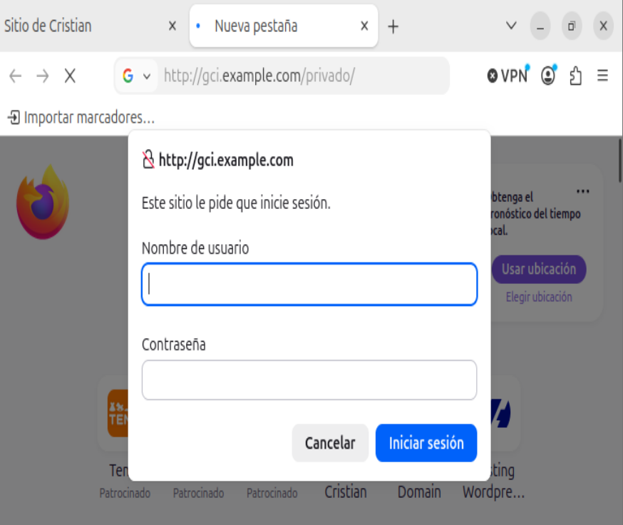

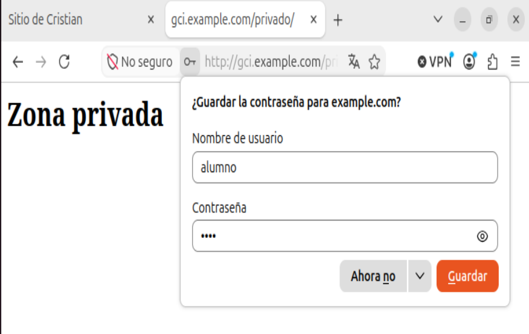

---

## 2.6. Problemas encontrados

Durante la configuración de Apache pueden aparecer diferentes problemas. En la siguiente tabla se muestran algunos errores habituales, sus posibles causas y sus soluciones.

| Problema | Causa | Solución |
|---|---|---|
| `Syntax error` en `configtest` | Alguna directiva está mal escrita | Revisar el archivo `gci.conf`. |
| Sigue apareciendo la página por defecto | El sitio `000-default.conf` sigue activado | Desactivar el sitio predeterminado si es necesario y recargar Apache. |
| `403 Forbidden` | Restricciones de acceso o permisos incorrectos | Revisar los permisos y las directivas `Require`. |
| `gci.example.com` no funciona | Falta la entrada correspondiente en `/etc/hosts` | Añadir el dominio con la IP correcta. |
| No aparece la solicitud de contraseña | Error en la configuración de autenticación | Revisar el bloque `<Directory>` y el archivo `.htpasswd`. |
| Un compañero no puede acceder | Problemas de red o firewall | Revisar la configuración de red de la máquina virtual. |

Sin modificar el archivo etc/hosts al poner la url nos daba este error:

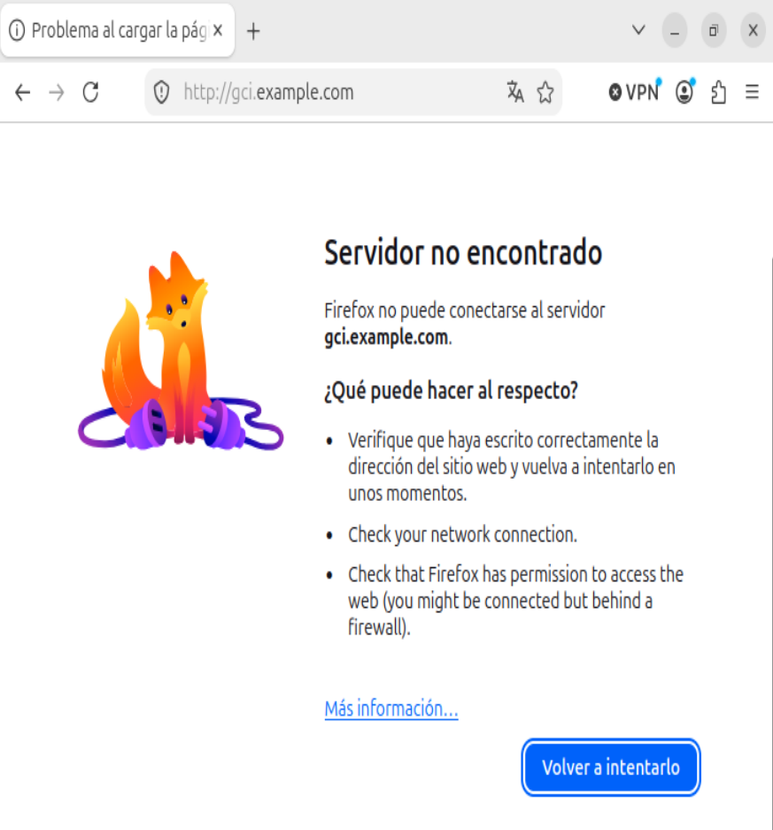

Una vez modificada se muestra el html con normalidad:

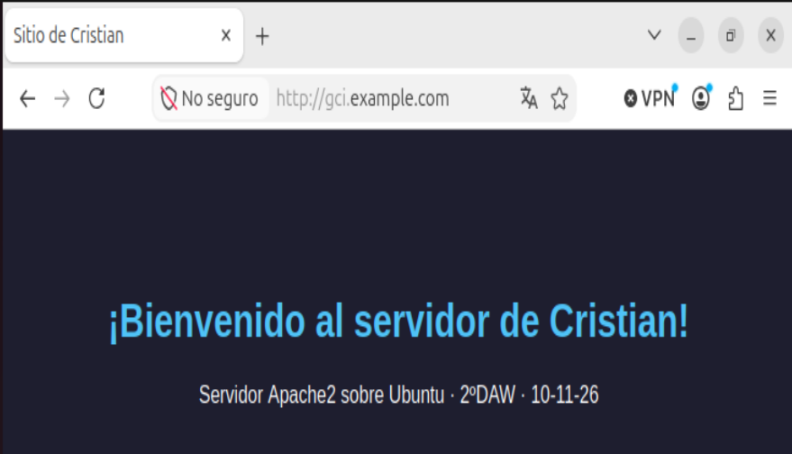

---

## 2.7. Banco de pruebas

Una vez terminada la configuración, se realizarán diferentes pruebas para comprobar que el servidor Apache funciona correctamente y que las medidas de seguridad están aplicadas.

| Nº | Prueba | Comando / Acción | Resultado esperado | Resultado obtenido | OK/KO |
|---|---|---|---|---|---|
| 1 | Servicio activo | `systemctl status apache2` | `active (running)` | | |
| 2 | Sintaxis correcta | `apache2ctl configtest` | `Syntax OK` | | |
| 3 | Página personalizada | Abrir `http://gci.example.com` | Se muestra la página | | |
| 4 | Respuesta HTTP | `curl -I http://gci.example.com` | `200 OK` | | |
| 5 | Directorio inexistente | `curl -I http://gci.example.com/nada` | `404 Not Found` | | |
| 6 | Zona privada sin credenciales | Abrir `/privado/` | `401 Unauthorized` | | |
| 7 | Zona privada con credenciales | `curl -u alumno http://gci.example.com/privado/` | `200 OK` | | |
| 8 | Acceso desde otro equipo | Compañero abre la página del servidor | Se muestra la página | | |
| 9 | Prueba de seguridad | Intento de acceso a la zona privada | Solicita credenciales | | |
| 10 | Revisión de logs | `sudo tail /var/log/apache2/access.log` | Aparecen las peticiones | | |

### Comandos utilizados para las pruebas

Comprobar que Apache está funcionando:

```bash
sudo systemctl status apache2
```

Comprobar que la configuración es correcta:

```bash
sudo apache2ctl configtest
```

Comprobar la respuesta de la página principal:

```bash
curl -I http://gci.example.com
```

Comprobar el acceso a la zona privada sin credenciales:

```bash
curl -I http://gci.example.com/privado/
```

Comprobar el acceso con credenciales:

```bash
curl -u alumno http://gci.example.com/privado/
```

El sistema solicitará la contraseña y, si es correcta, permitirá visualizar el contenido.

Consultar los registros de acceso de Apache:

```bash
sudo tail -n 20 /var/log/apache2/access.log
```

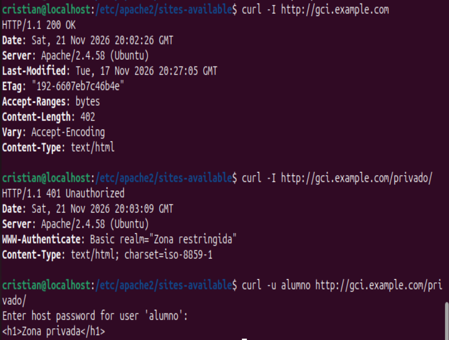

---

## 2.8. Prueba desde otro ordenador

Para comprobar que el servidor es accesible desde otros equipos, se solicitará a un compañero que intente conectarse desde su ordenador.

Primero, consultamos la dirección IP de nuestra máquina virtual Ubuntu:

```bash
hostname -I
```

A continuación, el compañero deberá configurar el archivo `hosts` de su equipo para asociar la IP de la máquina virtual con el dominio `gci.example.com`.

Después, abrirá el navegador e introducirá:

`http://gci.example.com`

Si la conexión funciona, podrá visualizar la página principal.

A continuación, intentará acceder a la zona privada:

`http://gci.example.com/privado/`

Apache solicitará el usuario y la contraseña para permitir el acceso.

De esta manera, se comprobará que otros equipos pueden acceder a la página principal, pero que la zona privada está protegida mediante autenticación.

Obtenemos la dirección IP de nuestra máquina virtual Ubuntu.

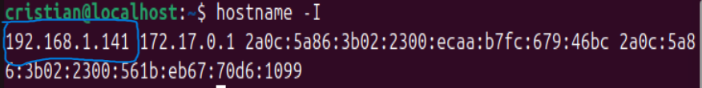

Modificamos el archivo `hosts` del ordenador de nuestro compañero para asociar nuestra IP con el dominio `gci.example.com`.

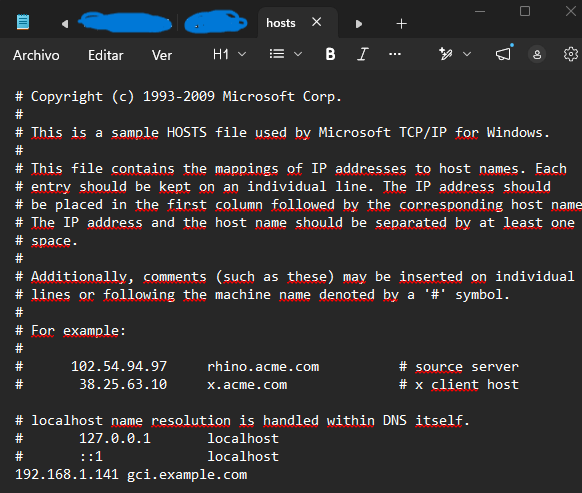

Comprobamos mediante el comando `ping` que el ordenador de nuestro compañero puede comunicarse con nuestra máquina virtual.

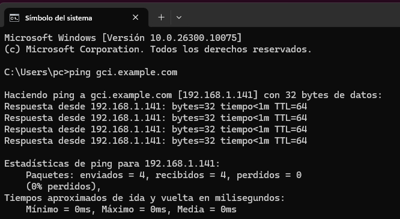

Accedemos desde el navegador del ordenador de nuestro compañero a la misma URL (`http://gci.example.com`) y comprobamos que se muestra nuestra página web.

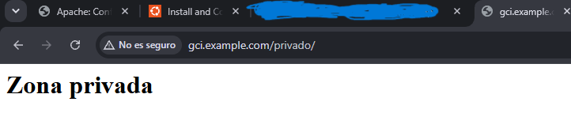

Por último, comprobamos desde Ubuntu, consultando el registro de accesos de Apache, que el ordenador de nuestro compañero ha realizado peticiones a nuestro servidor. 

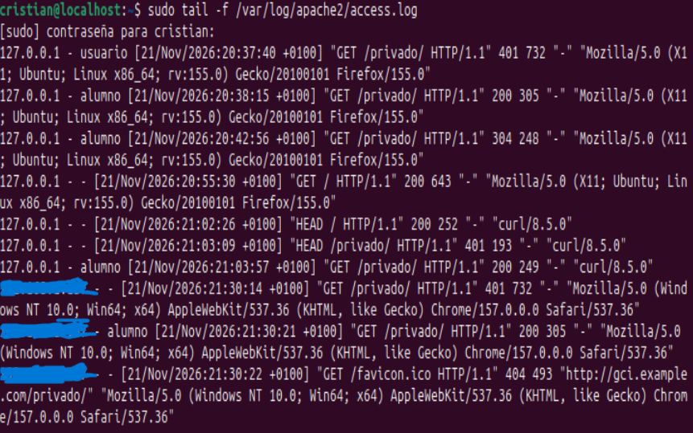
---

## 3. Presentación y valoración de resultados

Una vez finalizada la práctica, se analizarán los resultados obtenidos durante la instalación y configuración del servidor Apache.

- Se instaló y verificó Apache2 en Ubuntu correctamente.
- Se publicó una página web personalizada mediante un VirtualHost propio llamado `gci.conf`.
- Se configuró el dominio `gci.example.com` para acceder a la página web.
- Se implementó un sistema de autenticación básica mediante usuario y contraseña para proteger una carpeta privada.
- Se realizaron diferentes pruebas para comprobar el funcionamiento del servidor y las restricciones de acceso.
- Se comprobó el acceso desde otro equipo para verificar el funcionamiento de la configuración.

### Comparación con compañeros

Se compararán los resultados obtenidos con los de otros compañeros, indicando qué tutoriales utilizaron, qué configuraciones realizaron y si encontraron problemas similares durante la práctica.

### Valoración personal

La realización de esta práctica ha permitido aprender a instalar y configurar un servidor web Apache en Ubuntu, crear un VirtualHost y gestionar el acceso a diferentes directorios.

La parte más interesante ha sido configurar la autenticación mediante usuario y contraseña, ya que permite proteger determinadas zonas de una página web.

También se ha aprendido a comprobar el funcionamiento del servidor mediante comandos y pruebas desde otros equipos.

---

## 4. Conclusión

Con esta práctica se han adquirido conocimientos sobre la instalación, configuración y administración de un servidor web Apache en Ubuntu. Se ha conseguido publicar una página web personalizada mediante un VirtualHost y configurar un sistema de control de acceso para proteger una zona privada. Además, se han realizado diferentes pruebas para comprobar su funcionamiento y detectar posibles errores. Como posibles mejoras futuras, se podría configurar HTTPS mediante certificados SSL, instalar PHP o crear nuevos VirtualHosts para alojar diferentes páginas web.

---

## 5. Bibliografía

- Canonical. *Install and configure Apache*. https://ubuntu.com/tutorials/install-and-configure-apache
- Apache Software Foundation. *Authentication, Authorization and Access Control*. https://httpd.apache.org/docs/2.4/howto/auth.html
- Apache Software Foundation. *Authentication and Authorization*. https://httpd.apache.org/docs/2.4/howto/auth.html

---

## 6. Anexos

En este apartado se incluye información adicional que puede resultar útil para comprender la configuración realizada.

- **Anexo A:** archivo de configuración completo `gci.conf`.
- **Anexo B:** comandos útiles para administrar Apache.

```bash
sudo systemctl start apache2
sudo systemctl stop apache2
sudo systemctl restart apache2
sudo systemctl reload apache2

sudo a2ensite gci.conf
sudo a2dissite gci.conf

sudo a2enmod rewrite
sudo apache2ctl -S
```
```