# Implementación de HTTPS en Apache2 sobre Ubuntu

**Autor/a:** Cristian Roca Parra
**Módulo:** [Despliegue de Aplicaciones Web – 2º DAW]
**Fecha:** [21/11/2026]

---

## 1. Resumen de la investigación teórica

### 1.1. Funcionamiento del protocolo HTTPS y su importancia

**HTTPS** (HTTP Secure) es HTTP transportado sobre una capa de cifrado **TLS** (antiguamente SSL). Usa por defecto el puerto **443**.

**Funcionamiento simplificado (handshake TLS):**
1. El cliente contacta con el servidor e indica las versiones de TLS y los algoritmos de cifrado que soporta (*ClientHello*).
2. El servidor responde con el algoritmo elegido y su **certificado digital** (que contiene su clave pública y su identidad).
3. El cliente verifica el certificado: que no ha caducado, que coincide con el dominio y que está firmado por una entidad en la que confía.
4. Ambos acuerdan una **clave de sesión** mediante criptografía asimétrica (intercambio de claves).
5. A partir de ahí, todo el tráfico se cifra con **criptografía simétrica** (más rápida) usando esa clave de sesión.

**Importancia:**
- **Confidencialidad:** nadie puede leer los datos en tránsito (contraseñas, formularios).
- **Integridad:** los datos no pueden modificarse sin que se detecte.
- **Autenticación:** el usuario comprueba que habla con el servidor legítimo (evita suplantaciones y ataques *man-in-the-middle*).
- Además: es requisito de los navegadores modernos (aviso "No seguro" en HTTP), mejora el SEO y es necesario para HTTP/2.

### 1.2. Tipos de certificados SSL/TLS

| Característica | Autofirmado | Emitido por CA confiable (ej. Let's Encrypt) |
|---|---|---|
| Quién lo firma | El propio servidor | Una Autoridad de Certificación reconocida |
| Confianza del navegador | **No**, muestra advertencia de seguridad | **Sí**, aparece el candado |
| Coste | Gratis | Gratis (Let's Encrypt) o de pago (comerciales) |
| Requisitos | Ninguno | Dominio público y accesible desde Internet |
| Validez | La que se quiera | Let's Encrypt: 90 días (renovación automática) |
| Uso recomendado | Pruebas, laboratorio, redes internas | Producción |

*(Opcional: mencionar tipos por validación DV / OV / EV y certificados wildcard.)*

### 1.3. Módulos de Apache2 necesarios

| Módulo | Función |
|---|---|
| `ssl` | Imprescindible. Añade el soporte SSL/TLS (`SSLEngine`, `SSLCertificateFile`...). |
| `headers` | Permite añadir cabeceras de seguridad, como HSTS. |
| `rewrite` | (Opcional) Permite la redirección HTTP → HTTPS con reglas de reescritura. |

Se activan con `a2enmod`.

---

## 2. Implementación paso a paso

### 2.1. Instalación y verificación de Apache2

```bash
sudo apt update
sudo apt install apache2 -y
sudo systemctl status apache2
```
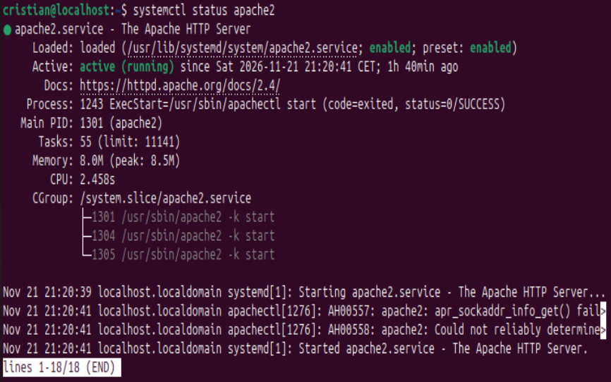

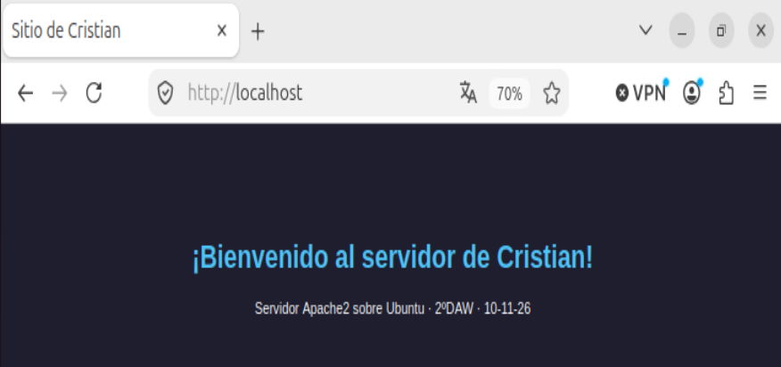

### 2.2. Habilitar los módulos SSL y headers

```bash
sudo a2enmod ssl
sudo a2enmod headers
sudo a2enmod rewrite      # solo si se usa redirección con RewriteEngine
sudo systemctl restart apache2
apache2ctl -M | grep -E "ssl|headers|rewrite"
```

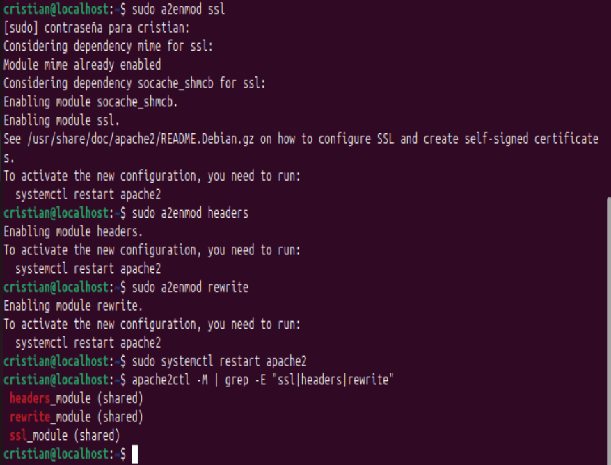

### 2.3. Generación del certificado

Se prepara primero el sitio:

```bash
sudo mkdir -p /var/www/misitio
echo "<h1>Sitio seguro con HTTPS</h1>" | sudo tee /var/www/misitio/index.html
```

#### Opción A: Certificado autofirmado (recomendada en laboratorio / máquina virtual)

```bash
sudo openssl req -x509 -nodes -days 365 -newkey rsa:2048 \
  -keyout /etc/ssl/private/misitio.key \
  -out /etc/ssl/certs/misitio.crt \
  -subj "/C=ES/ST=[Provincia]/L=[Localidad]/O=[Centro]/CN=misitio.local"
```

- `-x509`: genera directamente un certificado autofirmado.
- `-nodes`: la clave privada no se protege con contraseña (así Apache arranca sin pedirla).
- `-days 365`: validez de un año.
- `-newkey rsa:2048`: crea una clave RSA de 2048 bits.
- `CN`: debe coincidir con el nombre con el que se accederá al sitio.

Se comprueba:

```bash
sudo openssl x509 -in /etc/ssl/certs/misitio.crt -text -noout | head -n 20
```
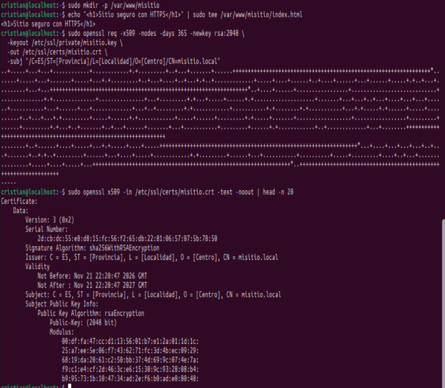

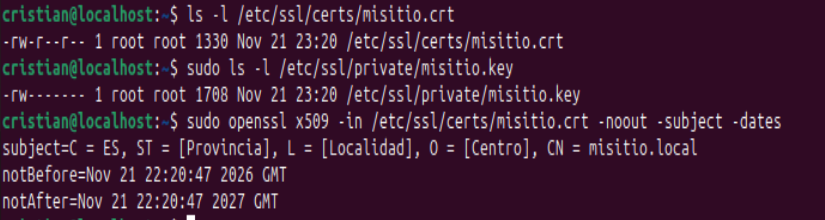

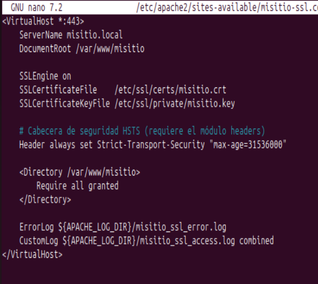

### 2.4. Configuración del VirtualHost en el puerto 443

```bash
sudo nano /etc/apache2/sites-available/misitio-ssl.conf
```

```apache
<VirtualHost *:443>
    ServerName misitio.local
    DocumentRoot /var/www/misitio

    SSLEngine on
    SSLCertificateFile    /etc/ssl/certs/misitio.crt
    SSLCertificateKeyFile /etc/ssl/private/misitio.key

    # Cabecera de seguridad HSTS (requiere el módulo headers)
    Header always set Strict-Transport-Security "max-age=31536000"

    <Directory /var/www/misitio>
        Require all granted
    </Directory>

    ErrorLog ${APACHE_LOG_DIR}/misitio_ssl_error.log
    CustomLog ${APACHE_LOG_DIR}/misitio_ssl_access.log combined
</VirtualHost>
```
Ctrl O (Guardar), Enter (Confirmar), Ctrl X (Salir)

Se habilita y se abre el puerto en el firewall (si UFW está activo):

```bash
sudo a2ensite misitio-ssl.conf
sudo ufw allow 'Apache Full'
```
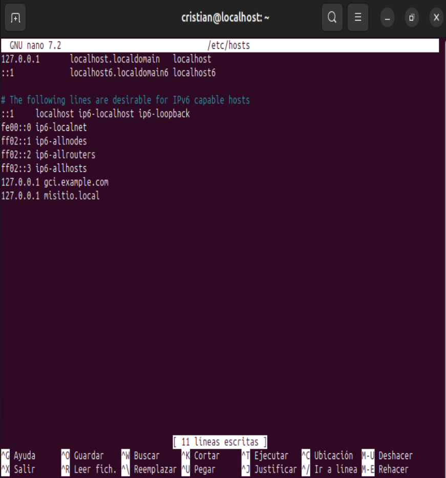

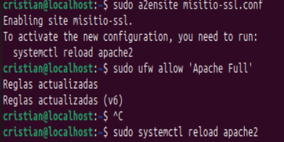

### 2.5. Redirección HTTP → HTTPS (opcional pero recomendada)

Se crea o edita el VirtualHost del puerto 80:

```apache
<VirtualHost *:80>
    ServerName misitio.local
    Redirect permanent / https://misitio.local/
</VirtualHost>
```

*Alternativa con `mod_rewrite`:*

```apache
<VirtualHost *:80>
    ServerName misitio.local
    RewriteEngine On
    RewriteRule ^(.*)$ https://%{HTTP_HOST}$1 [R=301,L]
</VirtualHost>
```

Se añade el nombre al archivo `/etc/hosts` del cliente: `127.0.0.1 misitio.local` (o la IP del servidor).

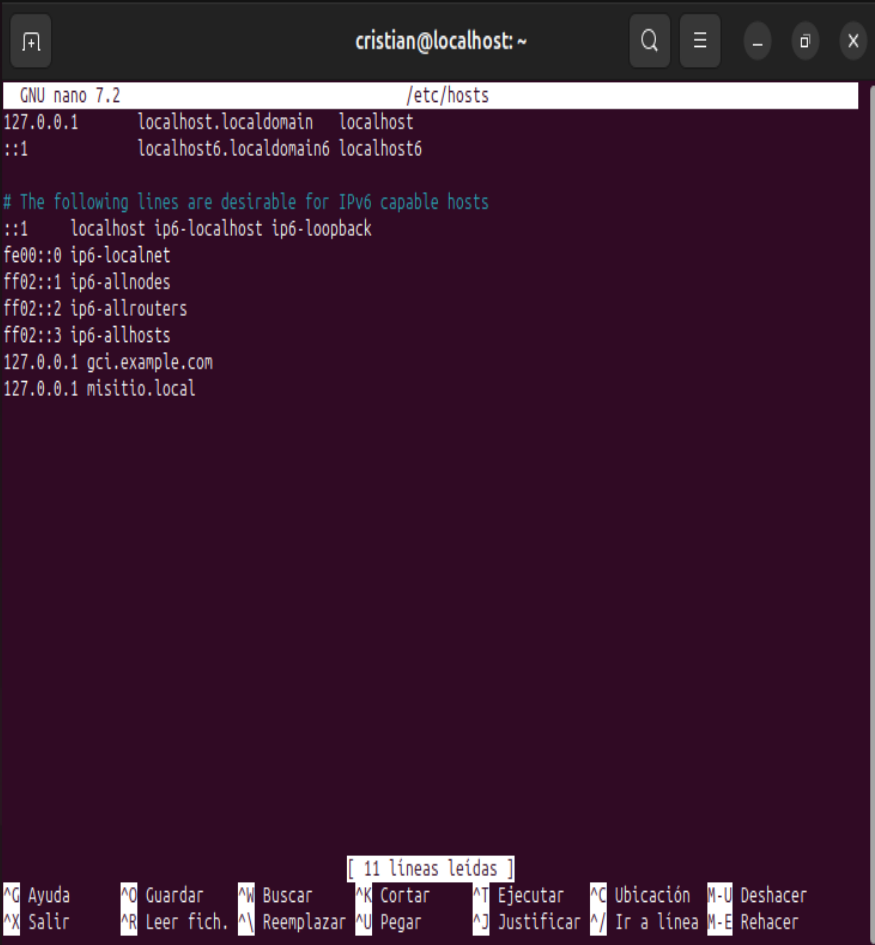

### 2.6. Reinicio y validación

```bash
sudo apache2ctl configtest
sudo systemctl reload apache2
```
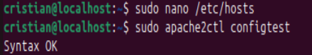

**Pruebas:**

```bash
# Respuesta por HTTPS (-k acepta el certificado autofirmado)
curl -k -I https://misitio.local

# Comprobar la redirección (debe devolver 301 y Location: https://...)
curl -I http://misitio.local

# Ver el certificado y el protocolo negociado
openssl s_client -connect misitio.local:443 -servername misitio.local </dev/null | head -n 20

# Comprobar que Apache escucha en el 443
sudo ss -tlnp | grep 443
```

**En el navegador:** acceder a `https://misitio.local`. Con certificado autofirmado aparecerá una advertencia; hay que aceptar el riesgo para continuar. Después, ver los detalles del certificado.

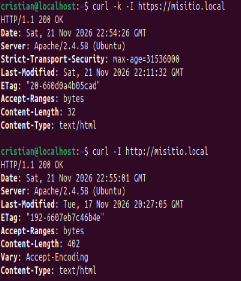

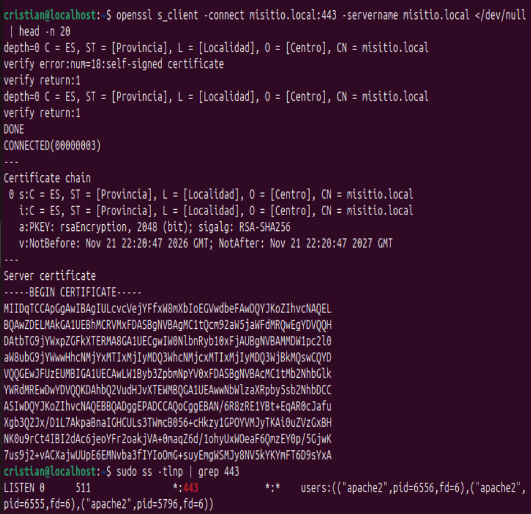

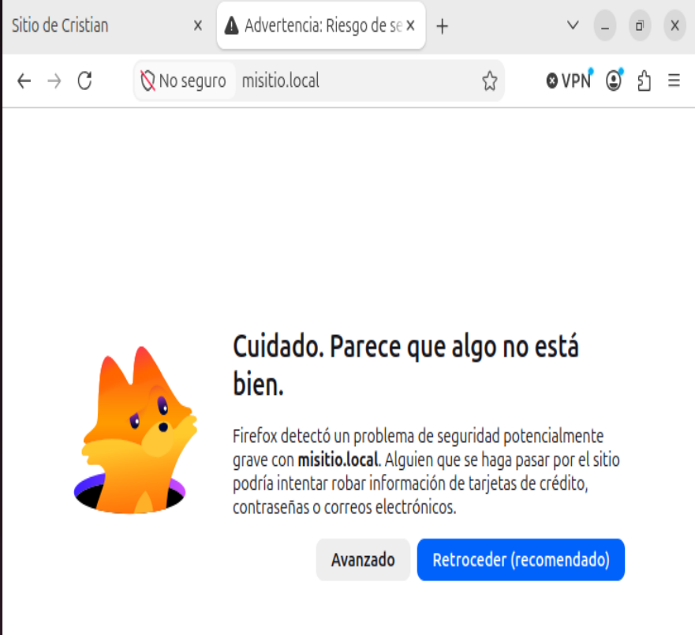

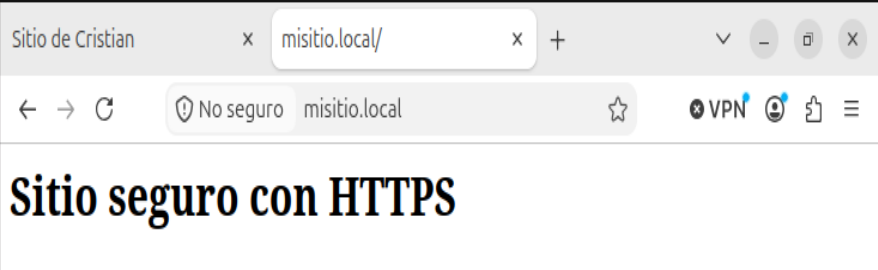


### 2.7. Tabla de verificación

| Nº | Prueba | Resultado esperado | Obtenido | OK/KO |
|---|---|---|---|---|
| 1 | Módulos ssl y headers cargados | Aparecen en `apache2ctl -M` | | |
| 2 | Sintaxis de configuración | Syntax OK | | |
| 3 | Apache escucha en el 443 | Línea con `:443` en `ss` | | |
| 4 | Acceso `https://` | Página visible | | |
| 5 | Redirección HTTP→HTTPS | 301 hacia https | | |
| 6 | Cabecera HSTS | Presente en la respuesta | | |

---

## 3. Conclusiones y dificultades encontradas

### Conclusiones
*(Redáctalas con tus palabras. Ideas:)*
- HTTPS cifra la comunicación y garantiza la identidad del servidor; hoy es imprescindible en cualquier sitio.
- El certificado autofirmado sirve para pruebas pero no es de confianza para los navegadores; en producción se usa una CA como Let's Encrypt.
- La redirección y HSTS completan la implementación, evitando accesos accidentales por HTTP.

### Dificultades encontradas
*(Anota las reales. Habituales:)*

| Dificultad | Solución |
|---|---|
| `Invalid command 'SSLEngine'` | No estaba habilitado el módulo `ssl` → `a2enmod ssl` |
| El navegador avisa de sitio no seguro | Normal en autofirmado; el CN debe coincidir con el nombre usado |
| Apache no arranca: no encuentra el `.key` | Ruta incorrecta o permisos de la clave privada |
| Puerto 443 no accesible desde otro equipo | Firewall (`ufw allow 'Apache Full'`) o red NAT |
| Certbot falla la validación | Sin dominio público ni puertos abiertos hacia Internet |
| Redirección en bucle | Regla de redirección colocada también en el VirtualHost 443 |

---

## Bibliografía

- Apache Software Foundation. *Apache Module mod_ssl*. https://httpd.apache.org/docs/2.4/mod/mod_ssl.html
- Apache Software Foundation. *SSL/TLS Strong Encryption: How-To*. https://httpd.apache.org/docs/2.4/ssl/ssl_howto.html
- Let's Encrypt. *Cómo funciona*. https://letsencrypt.org/es/how-it-works/
- Certbot. *Instrucciones para Apache en Ubuntu*. https://certbot.eff.org/
- [Otras webs consultadas, con fecha de consulta]
