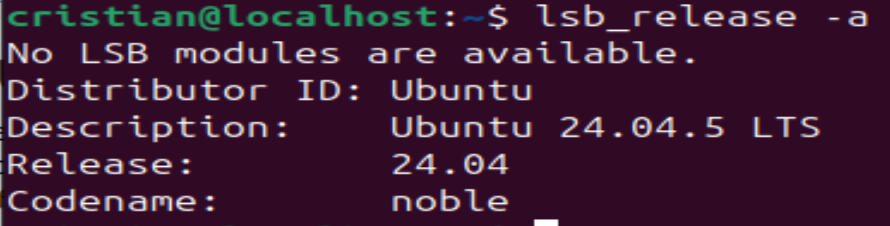
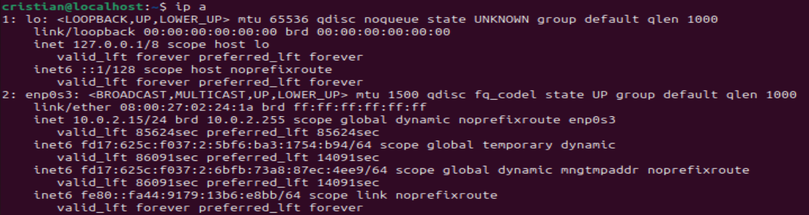

# Instalación y configuración de un servidor web Apache en Ubuntu

**Autor/a:** [Cristian Roca Parra]
**Curso / Módulo:** [2º DAW – Despliegue de Aplicaciones Web]
**Fecha:** [10/11/2026]

---

## Resumen

> ⚠️ **Este apartado se redacta AL FINAL**, cuando tengas terminado todo el documento. Debe ocupar entre 5 y 10 líneas.
>
> Plantilla para rellenar:
> *En este trabajo se documenta la instalación y configuración del servidor web Apache2 sobre Ubuntu 24.04.5.1. Se ha creado un sitio web personalizado, se ha configurado un VirtualHost propio y se ha habilitado mediante `a2ensite`. Además, se ha puesto en práctica un tutorial adicional sobre [control de acceso]. Cada fase se ha verificado con un banco de pruebas, incluyendo pruebas desde otro equipo realizadas por un compañero. Los resultados obtenidos han sido [...] y los principales problemas encontrados fueron [...]. Como conclusión, [valoración breve].*

## Palabras clave

`Apache2` · `Ubuntu` · `Servidor web` · `VirtualHost` · `HTTP` · `Control de acceso` · `Configuración` · `Linux`

## Índice

1. Introducción
   1. Contexto
   2. Entorno utilizado: Apache
   3. Alternativas
   4. Motivación
2. Relación de actividades realizadas *(ver documento 2)*
3. Presentación y valoración de resultados *(ver documento 2)*
4. Conclusión *(ver documento 2)*
5. Bibliografía
6. Anexos

> 💡 Cuando juntes los documentos en uno solo, genera el índice con enlaces internos (en Markdown: `[Contexto](#11-contexto)`).

---

## 1. Introducción

### 1.1. Contexto

El proyecto se realiza en IES Juan Bosco, dentro del módulo de Despliegue de aplicaciones web del ciclo 2ºDAW. El trabajo se desarrolla de forma individual en una máquina virtual con las siguientes características:

| Sistema operativo | Ubuntu [Server/Desktop] [versión, 24.04.5.1 LTS] |
| Hipervisor | [Oracle VirtualBox] |
| RAM / CPU / Disco | [ej. 10 GB / 3 vCPU / 100 GB] |
| Red | [NAT] |
| IP de la máquina | [ej. 192.168.1.50] |

### 1.2. Entorno utilizado: Apache

**¿Qué es?** Apache HTTP Server (o simplemente *Apache*) es un servidor web de código abierto y multiplataforma. Su función es recibir peticiones HTTP/HTTPS de los clientes (navegadores) y responder con el contenido solicitado: páginas HTML, imágenes, archivos o resultados de aplicaciones dinámicas (PHP, Python, etc.).

**¿Para qué sirve?**
- Alojar sitios web estáticos y dinámicos.
- Servir varios sitios en un mismo servidor mediante *VirtualHosts*.
- Controlar el acceso a recursos (autenticación, restricciones por IP).
- Ampliar funcionalidades mediante módulos (SSL, reescritura de URLs, proxy, etc.).

**Historia (resumen):**
- **1995:** nace a partir del servidor NCSA HTTPd, mantenido mediante parches aportados por una comunidad de desarrolladores.
- **1999:** se funda la *Apache Software Foundation* para dar soporte legal y organizativo al proyecto.
- **Años posteriores:** durante mucho tiempo fue el servidor web más utilizado del mundo. La rama actual es la **2.4**.

*(Contrasta estas fechas con la web oficial de Apache y cítala en la bibliografía.)*

### 1.3. Alternativas

| Alternativa | Breve descripción |
|---|---|
| **Nginx** | Servidor web y proxy inverso muy ligero y eficiente con muchas conexiones simultáneas. |
| **LiteSpeed** | Servidor de alto rendimiento, compatible con la configuración de Apache; versión gratuita (OpenLiteSpeed) y de pago. |
| **Caddy** | Servidor moderno con HTTPS automático y configuración muy sencilla. |
| **Microsoft IIS** | Servidor web de Microsoft para Windows Server. |
| **Lighttpd** | Servidor muy ligero, pensado para sistemas con pocos recursos. |

### 1.4. Motivación

El objetivo de este proyecto es aprender a instalar y administrar un servidor web real, ya que es una competencia básica en el despliegue de aplicaciones web. Concretamente, se pretende:

- Instalar Apache2 en Ubuntu y comprobar que funciona correctamente.
- Crear un sitio web personalizado y publicarlo mediante un VirtualHost propio.
- Ampliar conocimientos aplicando un tutorial adicional (control de acceso).
- Documentar todo el proceso, incluyendo los errores encontrados, de forma que pueda reproducirse.

---

## Bibliografía

- Apache Software Foundation. *Apache HTTP Server Project*. https://httpd.apache.org/ *(consultado el dd/mm/2026)*
- Canonical. *Install and configure Apache*. https://ubuntu.com/tutorials/install-and-configure-apache *(consultado el dd/mm/2026)*
- [Añade aquí el tutorial adicional de control de acceso]
- [Resto de webs consultadas]
